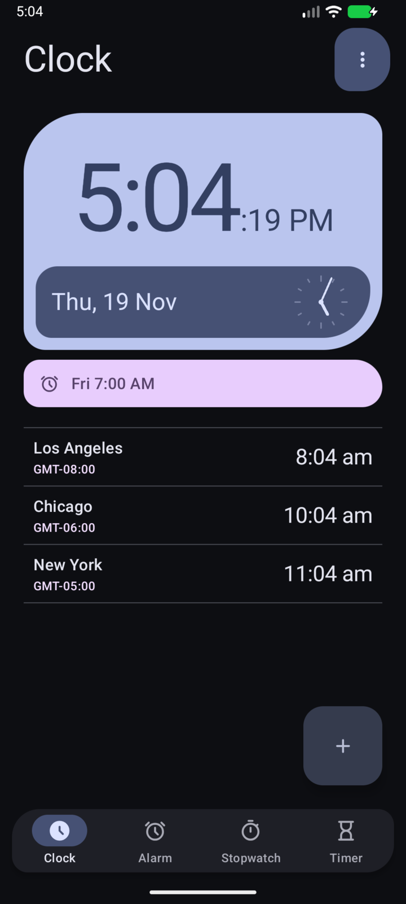
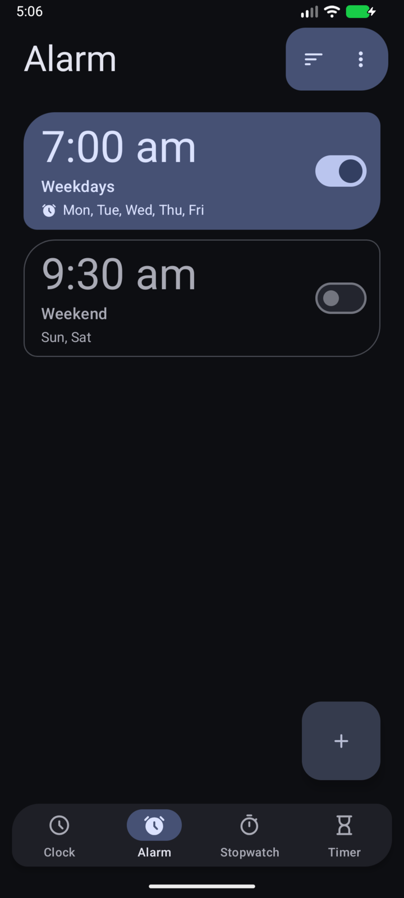
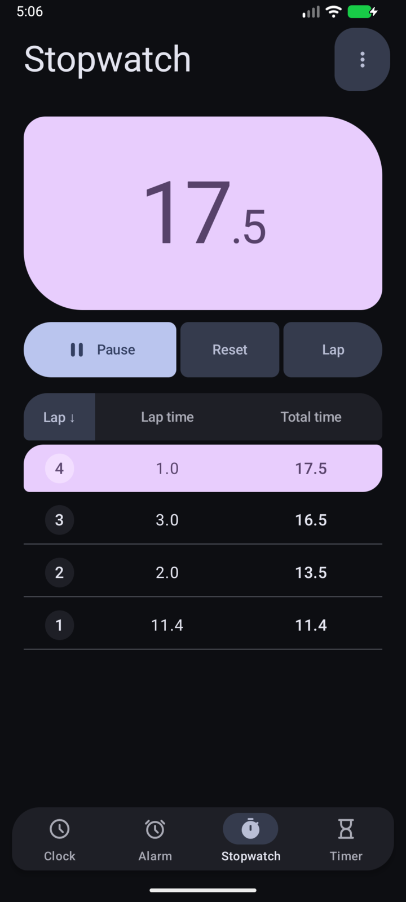
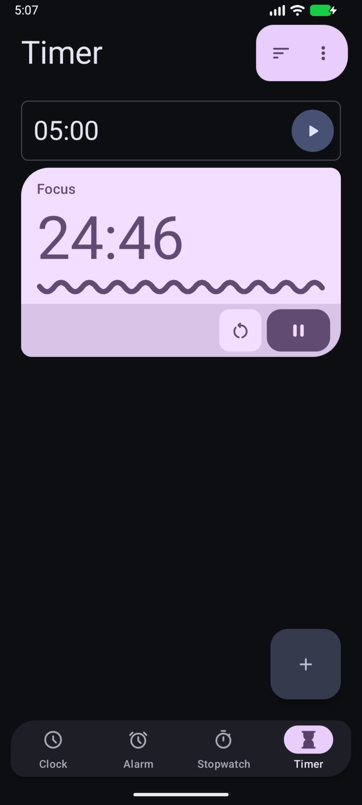

# Clock Expressive

**This redesign was made using AI agents.**

Clock Expressive is an unofficial Android fork of [Fossify Clock](https://github.com/FossifyOrg/Clock), redesigned with Jetpack Compose and Material 3 Expressive. It works offline and is ad-free.

**[Download the APK from GitHub Releases](https://github.com/ch7amada/Clock-Expressive/releases/latest)** · Requires Android 8.0 or later.

Download the `.apk` from the release assets and open it on your device. Clock Expressive shares Fossify Clock's Android package ID and uses its own signing key. If you have a copy signed with another key, export your alarms and timers before uninstalling it, then install this APK and import your backup.

## Features

- **Clock** displays local time, the next alarm, and saved world clocks.
- **Alarms** support recurring days, custom sounds, vibration, and snooze.
- **Stopwatch** tracks elapsed time and laps.
- **Timers** support reusable presets, custom sounds, and vibration.
- **Appearance** includes light and dark modes, system colors, and curated palettes. Digital and analogue home-screen widgets follow Android's appearance.

## Screenshots

Captured on the Android emulator from the signed release APK.

| Clock | Alarm | Stopwatch | Timer |
| --- | --- | --- | --- |
|  |  |  |  |

## Upstream and license

The original app is maintained by Fossify. Clock Expressive is licensed under GPL-3.0. [Fossify Clock source](https://github.com/FossifyOrg/Clock) · [License](LICENSE)
